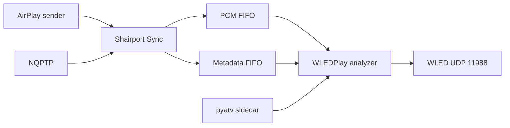

# Architecture

WLEDPlay does not implement AirPlay. Shairport Sync receives AirPlay 2, writes decoded PCM and metadata to FIFOs, and WLEDPlay analyzes that PCM and sends WLED Audio Sync V2 UDP.

`docker/entrypoint.sh` starts dbus, Avahi, NQPTP, Shairport Sync, the Auto Join sidecar, and `wledplay`. Rust is the config authority. Before exec, the shell reads a few top-level scalars from YAML with `sed` so it can fill environment variables. Nested settings are loaded by the Rust process, not by the shell.

## Modules

- [`src/app.rs`](../src/app.rs) wires the CLI, PCM input, metadata, and process lifetime.
- [`src/runtime.rs`](../src/runtime.rs) owns the send loop and status snapshots. Send delay is `audio.sync_offset_ms`. Departures share one grid: a wake that renders two windows leaves the second for the following slot, and the next wake continues after it. Each enabled unicast controller can add a millisecond offset to that hold. Controllers that share a send time leave as one queue entry. Multicast stays on the base hold. A missed transmission deadline and a missing analysis window are different events. A deadline more than one slot late, or more than four ahead, restarts at the current delay, and more than four waiting audio slots keeps the newest window. A wake with no new analysis window sends no spectrum, and the previous one is not reused.
- [`src/audio/`](../src/audio) is the analyzer: 22050 Hz, 512-point FFT, 16 bands. Each scheduled WLED packet renders one window ending on that packet's slot. Behavior follows WLED's audio-reactive map. The implementation is independent; see [`docs/LICENSING.md`](LICENSING.md).
- [`src/pcm/`](../src/pcm) downmixes and decimates incoming PCM to the analysis rate.
- [`src/wled/`](../src/wled) builds and sends Audio Sync V2 packets.
- [`src/auto_join/mod.rs`](../src/auto_join/mod.rs) is join policy. [`src/auto_join/sidecar.rs`](../src/auto_join/sidecar.rs) talks to [`docker/autojoin_sidecar.py`](../docker/autojoin_sidecar.py). Discovery is a standing Avahi browser of `_airplay._tcp` and `_raop._tcp`, plus a separate browser of `_wled._tcp`. pyatv runs only to send a join. WLED discovery updates the operator table. Control Save is what writes that table, and the enabled rows, into `config.yaml`.
- [`src/web/mod.rs`](../src/web/mod.rs) is the HTTP API. [`src/web/index.html`](../src/web/index.html) is the operator UI, compiled in with `include_str!`. A UI change is not visible until the binary is rebuilt.
- [`src/config.rs`](../src/config.rs) and [`src/control.rs`](../src/control.rs) load YAML and apply live patches.
- [`src/metadata/`](../src/metadata) parses the Shairport metadata pipe.
- [`src/clock.rs`](../src/clock.rs) and [`src/timing/`](../src/timing) track presentation timing. [`src/netif.rs`](../src/netif.rs) resolves NIC pins.

## Invariants

These are intentional. Do not remove them as cleanup.

- AirPlay 1 is unsupported. Grouping with HomePods and Apple TVs needs AirPlay 2 and NQPTP.
- [`docker/shairport-mixed-stack.patch`](../docker/shairport-mixed-stack.patch) and [`docker/nqptp-timing-peers.patch`](../docker/nqptp-timing-peers.patch) default on. `WLEDPLAY_SHAIRPORT_PATCH=0` and `WLEDPLAY_NQPTP_PATCH=0` build stock tags. Leave both switches in place.
- A paused group stays joined. Auto Join holds the membership instead of leaving on pause.
- Operator-facing Auto Join text must not say "phone". Internal identifiers such as `phone_owned` stay internal.
- The operator UI has no authentication. See [`SECURITY.md`](../SECURITY.md).
